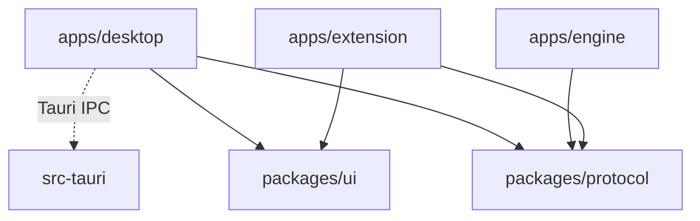

# 模块职责与依赖边界

本文只描述当前工程骨架的职责与允许依赖，不展开业务流程、协议字段或模型接入细节。

## 模块职责

| 路径                | 职责                                                                            | 构建入口                                                               |
| ------------------- | ------------------------------------------------------------------------------- | ---------------------------------------------------------------------- |
| `apps/desktop`      | 桌面前端（React + TanStack Router/Query/Form + Zustand）与 `src-tauri` 原生后端 | Vite+ (`vp dev` / `vp build`)、Tauri CLI (`tauri dev` / `tauri build`) |
| `apps/engine`       | 本地处理引擎入口，Node.js 24 直接运行 TypeScript                                | `node src/main.ts`、Vite+ (`vp pack`)                                  |
| `apps/extension`    | Chrome 扩展（Manifest V3），当前仅 popup                                        | WXT (`wxt` / `wxt build`)                                              |
| `packages/ui`       | 共享 shadcn/ui 组件、主题变量、图标与样式                                       | 无独立构建，源码由消费方打包                                           |
| `packages/protocol` | 跨模块通信契约的归属位置，当前无契约                                            | 暂无                                                                   |

原生能力（窗口、系统交互等）归属 `apps/desktop/src-tauri`；本地处理能力归属 `apps/engine`；浏览器页面与扩展能力归属各自应用。

## 允许的依赖方向

- 箭头表示源码依赖；虚线表示运行时通信。`packages/protocol` 目前为空，箭头表示后续契约的唯一归属位置。
- apps 之间不直接导入彼此的内部源码；跨应用复用只能通过 `packages/*`。
- packages 不依赖任何 app。
- `packages/ui` 只使用浏览器通用 API，不调用 Tauri、Chrome 扩展或 Node 专属 API。
- 平台相关代码留在对应应用内。

## 导入方式

- 共享 UI：`@sonasub/ui/components/*`、`@sonasub/ui/lib/*`、`@sonasub/ui/theme`、`@sonasub/ui/globals.css`。
- `packages/ui` 内部使用 `#lib/*` 包内别名；桌面端使用 `@/*` 指向 `apps/desktop/src`。
- 新增导出必须同时写入该包 `package.json` 的 `exports`，否则消费方无法解析。
- 声明 `vite` 的 workspace 使用 `npm:@voidzero-dev/vite-plus-core@<vite-plus 版本>` 别名，与 Vite+ 内置内核保持一致；WXT 与 Tauri 仍走各自 CLI。

## 样式与主题

- `packages/ui/src/styles/globals.css` 是 Tailwind 4 与 CSS 变量的唯一入口，包含 `@theme inline` 映射与 `.dark` 变量。
- 各应用在自身 CSS 入口中 `@import '@sonasub/ui/globals.css'`，再用 `@source` 扫描本应用源码；共享包通过 `globals.css` 内的 `@source` 扫描。JS 只导入应用自己的 CSS 入口。
- 主题状态由 `@sonasub/ui/theme` 的 Zustand store 管理，通过 `<html class="dark">` 生效。
- 应用图标位于 `apps/desktop/src-tauri/icons/icon.png`，由 `tauri.conf.json` 引用。
