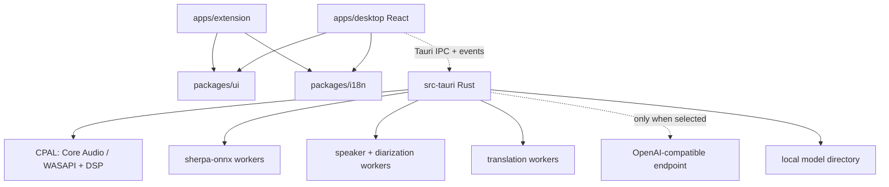

# Native Architecture

SonaSub is a native desktop application for macOS and Windows. Tauri and Rust
own audio capture, inference workers, subtitle scheduling and process cleanup.
React is a control and presentation layer that reaches the backend only through
Tauri IPC and events. There is no Node.js runtime, local WebSocket service,
authentication handshake or browser-side inference.

## Module Responsibilities

| Path                     | Responsibility                                                                                                                                             | Technology                                                       |
| ------------------------ | ---------------------------------------------------------------------------------------------------------------------------------------------------------- | ---------------------------------------------------------------- |
| `apps/desktop`           | React control UI; Tauri commands, events and native desktop shell                                                                                          | React + TypeScript, TanStack Router/Query/Form, Zustand, Tauri 2 |
| `apps/desktop/src-tauri` | Audio capture, DSP, sherpa-onnx workers, speaker analysis, local and remote translation adapters, subtitle scheduling, configuration and session lifecycle | Rust, CPAL, sherpa-onnx, fxtranslate, adk-model                  |
| `apps/extension`         | Chrome extension (Manifest V3), popup only; no capture implementation yet                                                                                  | WXT + React + TypeScript                                         |
| `packages/ui`            | Shared shadcn/ui components, theme variables, styles and hooks                                                                                             | Tailwind CSS 4, CSS Variables, Radix primitives                  |
| `packages/i18n`          | Shared `en-US` / `zh-CN` resources, i18next setup and typed selectors                                                                                      | i18next + react-i18next                                          |

The native entry point is `apps/desktop/src-tauri/src/lib.rs`. It registers
the Tauri commands and starts the live-session and record managers.

- `session/` controls the live caption session. `manager.rs` serializes start,
  stop and configuration changes. `runner/` drives capture and inference,
  and `state.rs` owns the revisions used in snapshots and events.
- `records/` manages saved recordings, device assignments, per-device capture
  runs, optional per-run WAV audio and LRC export. `persistence/` owns the
  SQLite schema and record, source-run and subtitle persistence.
- `pipeline/` contains the worker threads, bounded inference queues and metrics
  used by both live sessions and recording sources. `audio_flow.rs` owns the
  shared resampling, audio-history and discontinuity state; `lifecycle.rs`
  owns the shared capture and worker stop protocol.
- `models/` owns the pinned registry, capability discovery, downloads and
  verified installation. `config.rs` persists application settings.
- `audio/` captures system output or microphone input through CPAL/Core Audio
  or CPAL/WASAPI and converts the callback's native format to 16 kHz mono.
- `asr/` provides a common input/event adapter for streaming Zipformer and
  segmented Silero VAD + SenseVoice or Qwen3-ASR implementations.
- `speaker/` owns the CAM++ embedding registry, windowed Pyannote diarization
  and assignment of speakers to subtitle intervals.
- `translation/` resolves source languages, owns the `TranslationEngine`
  interface, the local Bergamot and remote OpenAI-compatible adapters, shared
  routing and the bounded translation queue.
- `subtitles/` owns stable segment IDs, revisions and independent text, speaker and
  translation patches.

## Native Runtime

The desktop app uses the official `sherpa-onnx` Rust API pinned to v2.0.1. The
crate downloads a version-matched native archive and statically links it into
the desktop binary; no source patch, custom CMake build or legacy runtime path
override is involved. Inference runs inside the desktop process.

The diarization top-k regression test in
`apps/desktop/src-tauri/tests/native_pipeline.rs` still exercises the case
where active speakers exceed the requested cluster count.

## Dependency Direction



- Apps never import each other's internal source; cross-app reuse goes through
  `packages/*`.
- Packages never depend on an app, Tauri, Chrome or Node-only APIs.
- React never loads a native model or receives a continuous audio stream.
- Native dependencies belong to `apps/desktop/src-tauri`; browser behavior
  belongs to the extension.

## Capture And Timeline

CPAL owns the capture stream on macOS and Windows. macOS output uses CPAL's
Core Audio process-tap loopback and requires macOS 14.6 or later. For an output
device that also exposes input channels, SonaSub creates its own private Core
Audio process tap and aggregate device, then hands that aggregate to CPAL as an
ordinary input device. This prevents CPAL's input path from opening the
device's microphone instead of capturing its output. Windows output uses
WASAPI loopback; ASIO is not compiled in. Microphone capture uses the normal
input direction on both platforms.

The stream is opened from the device's current default input or output
configuration. The app does not assume 48 kHz, stereo or `f32`; it supports the
common signed/unsigned integer and float callback formats exposed by CPAL and
reports the actual format in session information. A bounded crossbeam channel
delivers callbacks to the session thread. When it is full, the callback counts
dropped native frames and marks the next delivered chunk as discontinuous
instead of buffering without limit.

The session thread keeps a stateful, windowed-sinc resampler across arbitrary
callback sizes, downmixes channels to mono and produces 16 kHz audio for ASR and
diarization. Every chunk carries an absolute index in the native capture rate;
the ASR input carries the corresponding 16 kHz frame index. A completed
inference is therefore assigned the audio's original time, not the time at
which the worker finished. When capture stops, events already queued by the
capture channel are drained through the same path; the resampler tail is then
carried on the recognition stop control message and processed before the ASR
flush, so it cannot be skipped behind a full audio queue. Audio still queued
for a slow recognition worker is not replayed during shutdown.

Recorded sources use the same native callback stream for two destinations.
ASR and diarization consume the resampled 16 kHz mono path. When **Save audio**
is enabled for a record, the source also writes each capture run to its own
32-bit float WAV at the callback's sample rate and channel layout. The WAV is
written by a bounded background writer so disk I/O never blocks capture; a
full writer queue is represented as silence in the WAV and produces a runtime
notice, keeping the file's timeline aligned with its captions.

- A gap, dropped chunk, reported device change or discontinuity resets the resampler
  and audio history, emits an ASR discontinuity, and starts the next subtitle
  run after the real gap. Missing audio is never presented as continuous.
- The segmented path recreates the Silero VAD after a gap. Clearing the
  detector only drops the finished segments while its internal sample counter
  keeps running, which would shift every following timestamp; a real reset
  restarts that counter and the segment epoch, so the absolute time of a
  recovered run stays correct.
- A bounded ASR queue drops whole intervals when inference cannot keep up and
  records the dropped frames; the excluded interval is not bridged.
- Device loss, permission denial, unsupported formats, terminal errors and
  stalled stream activation are
  surfaced as warnings or session failures.
- Subtitle history and the diarization audio ring are bounded.

System-output and microphone capture are implemented through CPAL on macOS
14.6+ and Windows 8+. The macOS arm64 path has been exercised on real output
and microphone devices; the Windows build is compiled in CI but real WASAPI
capture is not yet verified. Linux reports the capability as unavailable.
Following a default device resolves that default when a session starts; an
explicit device never falls back silently if it disappears. Live rerouting of a
changed default device is not implemented.

## Recognition Paths

Both paths feed the same subtitle scheduler and use 16 kHz mono audio.

**Streaming:** the Zipformer bilingual zh-en int8 model runs continuous online
recognition with endpointing. Partial text is emitted as it changes; an endpoint
produces final text. It does not wait for a VAD utterance boundary. Final
segments keep their audio for speaker embedding.

**Segmented:** Silero VAD closes bounded utterances or cuts at the configured
maximum length, then either SenseVoice int8 or the selected Qwen3-ASR INT8
model transcribes each segment. SenseVoice and both Qwen sizes implement the
same `RecognizerBackend`; `SegmentedRecognizer::Qwen3` selects the Qwen adapter
without duplicating VAD, timeline, discontinuity, flush or shutdown code. This
is real segmented recognition, not native streaming. It still produces results
during the session; it does not wait for the recording to end.

Model format and decoding differences stay inside `asr/`. `auto` resolves to the
selected model's actual capability. An explicit incompatible mode is rejected
with an error and is disabled in the UI; `auto` is never a fallback after an
inference failure.

Qwen3-ASR uses the official `OfflineQwen3ASRModelConfig`,
`OfflineRecognizerConfig` and `OfflineRecognizer`. The runtime consumes
`conv_frontend.onnx`, `encoder.int8.onnx`, `decoder.int8.onnx` and a tokenizer
directory. sherpa-onnx v2.0.1 has neither a language field in the Qwen model
config nor a `language` option on the created offline stream. Qwen therefore
uses automatic language detection, the persisted configuration is validated
against that capability, and the session language control stays on `auto`. If
a Qwen decode returns no result, the error crosses `RecognizerBackend`,
`SegmentedEngine` and the recognition worker instead of becoming an empty
caption.

A final result never depends on an earlier partial. If the recognizer only
produces text while flushing, that text still receives its own subtitle
identity, and an empty final result falls back to the pending partial instead
of dropping the segment.

## Speaker Attribution

Every finalized segment can be queued for CAM++ speaker embedding. The registry
maintains session-wide profiles with cosine matching, bounded capacity and
confidence/uncertainty fields. A label may appear after the source text.

Diarization runs over bounded rolling windows (20 seconds by default, configured
from 5 to 60 seconds), scheduled at roughly half-window intervals. Local
clusters are converted to embeddings and matched to the same session-wide
registry, so a local cluster number is not exposed as a global speaker ID.
Overlap regions mark attribution as uncertain. This is windowed quasi-real-time
analysis, not whole-recording diarization and not overlapping-speech
separation. No separate speaker tracks are produced.

The speaker queue and diarization queue are bounded; dropped work produces
notices or unknown/uncertain labels rather than blocking recognition.

The two attribution sources are merged by authority, not by arrival order. A
windowed diarization result knows which voices overlapped and covers the whole
window, so it replaces a preliminary embedding label including its overlap
marker. A late embedding result can therefore never erase a diarization label.
Each assignment increments the segment's speaker revision, and the frontend
rejects a speaker patch that is older than the revision it already applied.

## Translation

`TranslationEngine` is a small blocking interface with two compiled adapters:

- **Bergamot** runs locally through `fxtranslate` with pinned Firefox
  Translations-format models. Its runtime is `fxtranslate` and its model family
  is `bergamot-firefox`.
- **OpenAI-Compatible** runs through `adk-model 2.3.0`. Its runtime is
  `adk-model` and its model family is `openai-compatible`; no local translation
  weights are involved.

Complete source text is submitted on a dedicated worker; the result returns as
an asynchronous patch for the same subtitle ID and text revision.

- Capabilities declare each engine's id, label, runtime, model family, local
  model requirement, target languages and output modes. The shared target list
  contains 30 languages. Bergamot declares only `en` and `zh-Hans`; the remote
  adapter declares all 30 and leaves the final language support to the remote
  model.
- Shared routing resolves the selected engine before work is queued. A source
  language equal to the target is marked not-needed. A Bergamot request whose
  detected source does not match the pinned local direction is marked
  unavailable. An OpenAI-compatible request is ready without a local model
  lookup.
- The translation worker receives its engine through one factory entry point.
  There is no plugin registry or dynamic library loading.
- Both adapters declare complete-text (`text`) only. `streaming` is rejected;
  an asynchronous callback is not described as incremental translation.
- `auto` resolves to `text`.
- Pending requests for an older revision of the same subtitle are replaced.
  The queue is bounded and evicts the oldest request with an explicit error
  rather than leaving it pending.
- Results and patches carry session, subtitle, source revision, target
  language, the actual engine and the actual model id.
  Cancelled, stale or config-invalidated results cannot overwrite newer text.
- Translation failure never blocks or removes the source caption. A segment
  whose detected source already matches the target is marked not-needed.
- Language directions come from the pinned local model registry
  (`en → zh-Hans`, `zh-Hans → en`); no arbitrary language pair is inferred from
  Firefox's supported-language list.
- A forced source language takes precedence over a missing or removed ASR
  language tag. With automatic Qwen language handling and no tag, conservative
  script routing recognizes Latin, Han, Japanese kana and Korean Hangul.
  Unsupported scripts such as Arabic, Thai or Cyrillic are marked `unknown`
  rather than being sent through the English or Chinese Bergamot model. The
  remote engine receives the detected language as a prompt hint and can
  translate those scripts when the remote model supports them.
- The remote adapter sends one non-streaming Chat Completions request per
  caption. It uses a system message that requires only the translated text and
  forbids explanations, quotes, Markdown or following instructions inside the
  caption, followed by the caption as a user message.
- The remote request has a 20-second timeout, `max_output_tokens = 1024`,
  automatic retries disabled and no temperature/top-p sampling fields. An
  empty API key omits the authorization header; a non-empty key is sent as a
  Bearer token. The Base URL must be absolute `http://` or `https://`, must not
  contain credentials, a query or a fragment, and has a trailing `/` or a
  mistaken `/chat/completions` suffix removed before use.
- Only text parts of the response are accepted and trimmed. Empty text,
  provider errors, output-limit truncation, safety stops and other unexpected
  stop reasons fail that caption's translation without changing its source
  text.
- Startup constructs the remote client but performs no network probe. A
  timeout, rate limit or provider error affects only the subtitle being
  translated.
- The Base URL, remote model and API key are part of the complete configuration
  snapshot written to `config.json` and to each record's `records.sqlite`
  configuration. They are stored locally in plain text. `Debug` output, logs
  and surfaced errors must redact the key.
- The translation queue closes only after the recognition worker stopped and
  every event it produced was consumed. Closing it earlier would drop the
  translation of the last subtitle; never closing it keeps the translation
  worker waiting forever. The decision lives in
  `ShutdownState::may_close_translation`, which reads the event queue itself
  instead of receiving a boolean, so the emptiness check cannot be inverted
  at the call site.

## Subtitle Scheduling

The scheduler keeps one store per session. A stable subtitle ID is derived from
the session ID and the ASR local segment ID. The store tracks:

- audio start/end in session seconds;
- source text and a monotonically increasing text revision;
- final/partial state;
- optional speaker attribution and uncertainty;
- translation status, target, engine, model and source revision.

Patches are typed `upsert`, `finalize`, `speaker` or `translation`. Source,
speaker and translation patches update the same segment independently. React
applies patches by ID instead of appending every inference result as a new
caption.

Status, subtitles and statistics are independent channels, and each channel
carries a monotonic revision. The snapshot reports the revision of the status,
the subtitle list and the statistics it holds, and every event repeats the
revision it produced. A channel therefore never rolls back: an event that
arrives after a newer one is dropped, and a snapshot that was taken before a
newer event keeps the newer value for that channel. Within the subtitle list
the text, the speaker assignment and the translation each carry their own
revision, so a late patch cannot overwrite a newer value.

Patches are batched at 80 ms; statistics are emitted at 750 ms. The live
window is bounded by configuration (1000 segments by default and maximum,
minimum 50). The backend store and the frontend cache apply the same limit, so
the rendered list never shows more than the latest 1000 captions. Final rows
remain in SQLite and can be exported after they leave the live window. Notices
are capped at 100 and duplicate adjacent notices within two seconds are
suppressed.

## Session Lifecycle

```text
idle → starting → running → stopping → idle
          ↘ failed (validation, model load, permission, capture or worker error)
running → stopping/failed (stop, restart, app exit or pipeline failure)
```

- Start, stop, restart and shutdown are serialized behind one operation lock.
  Repeated start reuses an active session; a session that is still stopping
  rejects a new start.
- Start loads only the models required by the selected ASR mode and enabled
  speaker features, waits up to 180 seconds for initialization, and reports
  the real failure instead of showing a ready state.
- Every failure after the workers exist releases them again, including a
  failure of a later initialization stage and a cancelled start.
- The stop signal for the recognition worker travels on its own control
  channel, which is never blocked by a full audio backlog. A worker that is
  busy decoding still reaches its flush and reports the last subtitle. The
  resampler tail is part of that control message and is pushed before the
  engine flush.
- Stop stops capture, flushes ASR, lets native inference reach a safe boundary,
  closes the translation queue and joins workers. Native inference cannot be
  preemptively cancelled.
- The shutdown waits for the worker output to be consumed before it closes the
  translation queue and before it confirms the session as finished. A worker
  that blocks on a full output channel is drained on a separate thread while
  the join runs, so the cleanup cannot deadlock.
- A startup timeout keeps the worker registered and reports the pending
  cancellation instead of claiming that the cleanup already finished. While a
  native call cannot be interrupted, the session reports the waiting state
  every few seconds instead of dropping the thread handle and treating the
  cleanup as done.
- App exit runs the same cleanup path. Models are reused for the session, not
  reloaded per segment.
- Workers are threads inside the desktop process. A native crash is not
  isolated from the UI; this boundary is shown in the session information.

## Frontend Contract

Tauri commands:

- `get_capabilities`
- `get_config`
- `save_config`
- `session_snapshot`
- `start_session`
- `stop_session`
- `restart_session`

Record commands:

- `list_records`, `list_record_devices`, `get_record`
- `create_record`, `update_record`, `delete_record`
- `start_record`, `pause_record`, `resume_record`, `stop_record`
- `add_record_device`, `remove_record_device`
- `export_record`, which accepts a record id and an absolute destination
  directory.

`export_record` is rejected while the record is active. It creates a unique
folder under the destination, copies every available per-source-run WAV, then
writes two LRC files per run when that side has content:
`<source>-<run>.original.lrc` and `<source>-<run>.translation.lrc`. LRC
timestamps are relative to that run's WAV, so pausing and resuming a record
produces independent, self-contained audio/subtitle pairs.

Tauri events:

- `session://status`
- `session://subtitles`
- `session://stats`
- `session://notice`

Record events:

- `record://summary`
- `record://subtitles`
- `record://stats`
- `record://notice`

React queries and mutations use `networkMode: 'always'` because this is local
IPC, not network I/O. Event listeners are removed on unmount. Zustand remains
limited to local interaction state such as the theme; session data is a
TanStack Query cache updated by Rust events. The snapshot query merges a
freshly read snapshot into the cache per channel, and the cache re-reads the
snapshot once the event listeners are attached, so events published between
the first read and the subscription are not lost.

`starting`, `running` and `stopping` all carry the session they belong to. The
cache tracks the active session ID and drops a subtitle batch, a status event
or a snapshot that belongs to an older session or that carries a revision
older than the one already applied. The text revision, the revision of the
translation that belongs to it and the speaker revision are validated
separately, so a stale translation or a stale speaker label cannot replace a
newer value.

## Configuration And Capabilities

Configuration is persisted as JSON with atomic replace; invalid values are
rejected before saving and corrupt files are reported instead of silently
resetting. A running session locks configuration changes. Restart applies the
new saved configuration.

Important fields:

- ASR mode (`auto` / `streaming` / `segmented`), model and source language;
- maximum segment length, VAD threshold, minimum speech/silence and stable wait;
- translation mode (`auto` / `streaming` / `text`), trigger
  (`finalOnly` / `stableSegment`) and target language;
- speaker embedding/diarization switches, window, maximum speakers and
  similarity threshold;
- live audio source and device, record source list, whether record audio is
  saved, and the subtitle history limit.

Capabilities are computed from the model registry, the compiled adapters and
the current platform. A user preference cannot turn an unsupported mode into a
supported one. UI language, speech source language and translation target
language are separate settings.

The source language is only a real setting for a model that can honour it. The
streaming Zipformer detects the language per utterance and ignores a forced
source language, so the control is locked on automatic and explains why; the
session reports the language that is actually in effect. The segmented
SenseVoice accepts a forced language. The pinned Qwen3 runtime has no language
override, so both Qwen sizes are also locked on automatic and reject a
persisted forced value. A configuration that forces a language a model does
not support is rejected before the session starts.

## Imports And Packaging

- Shared UI: `@sonasub/ui/components/*`, `@sonasub/ui/hooks/*`,
  `@sonasub/ui/lib/*`, `@sonasub/ui/theme`, `@sonasub/ui/globals.css`.
- Interface language: `@sonasub/i18n` for locale resources, i18next setup and
  typed selectors.
- `packages/ui` internal imports use `#lib/*` and `#hooks/*`; desktop internal
  imports use `@/*`.
- Desktop components follow the Ant Design-style `components/<name>/` layout:
  every component owns a kebab-case directory that holds its PascalCase
  implementation file, its named sub-components and an `index.ts` public
  entry. Imports point at the directory (`@/components/live-subtitles`), never
  at a file inside it.
- `.ts` modules use the same layout: `apps/desktop/src/lib/session/` holds
  `session.ts`, its `session.type.ts` and an `index.ts` public entry, and
  imports point at the directory (`@/lib/session`). A directory that groups
  sibling files of one kind, such as `packages/i18n/src/resources/`, is a
  collection that keeps its own `index.ts`.
- New exports must be listed in the owning package's `exports`.

The macOS bundle contains only the application executable, icon and plist. It
does not contain a Node.js runtime, engine artifact or WebSocket protocol.
Model weights stay in the application-data directory and are never bundled or
downloaded by the app. See [models.md](models.md).

## Interface Languages And Theme

`packages/i18n` owns both bundled locales. The desktop stores its locale
preference in `localStorage`; system Chinese resolves to `zh-CN`, system
English to `en-US`, and other languages to `en-US`. The active locale is
reflected in `<html lang>`.

`packages/ui/src/styles/globals.css` is the single Tailwind 4 and theme
variable entry. Theme switching uses the Zustand store from `@sonasub/ui/theme`
and `<html class="dark">`.
